# Elite Nexus

**One native, fast companion for Elite Dangerous** — replacing the pile of tools commanders run side by side
(EDDiscovery, ED Market Connector, Odyssey Materials Helper, Observatory + BioInsights, Exploration Buddy,
EDCoPilot-style voice alerts, OD Elite Tracker) and the websites you alt-tab to (INARA, Spansh, EDSM, EDSY/Coriolis,
EDAstro, ED Tools, EDRefCard).

Pure Rust. No Python, no Node.js, no browser engine. One executable, GPU-rendered UI (egui/wgpu).

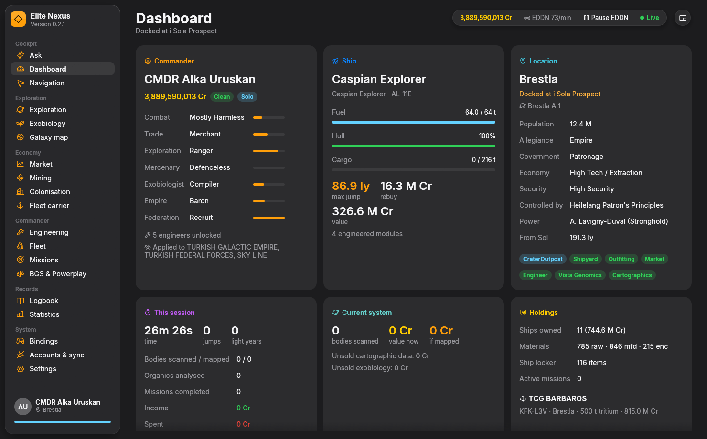

## Screenshots

| | |
|---|---|
| 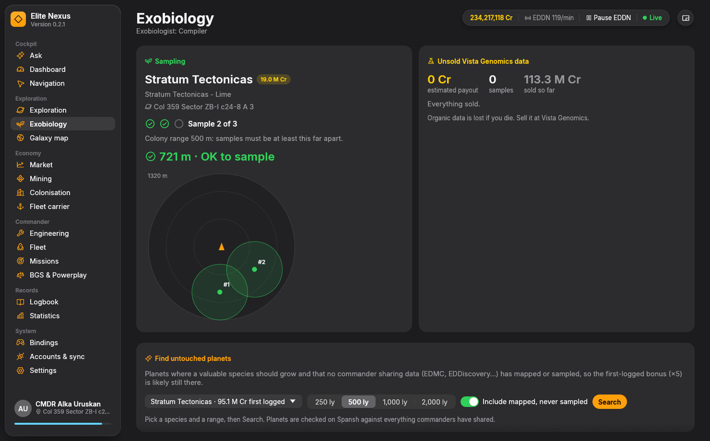 **Exobiology** — live sampling radar, colony range, species value | 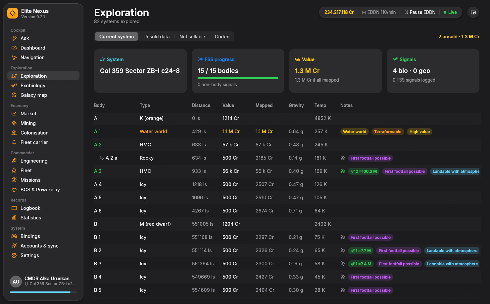 **Exploration** — every body, value now vs. mapped, highlights |
| 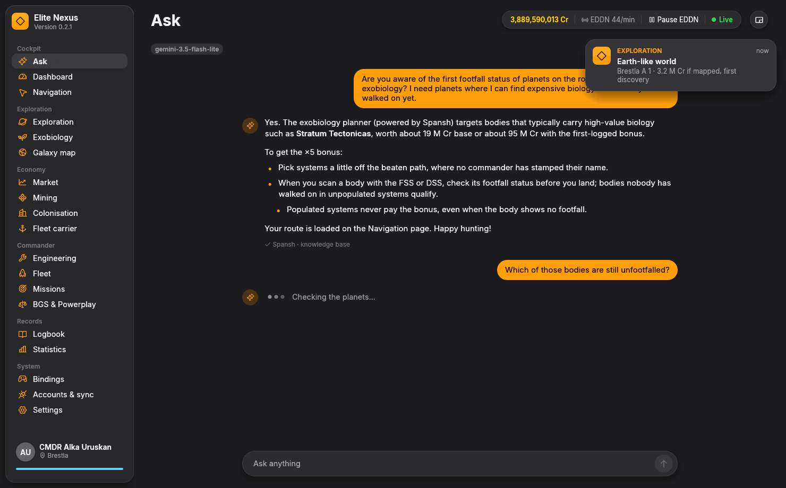 **Ask** — the AI co-pilot | 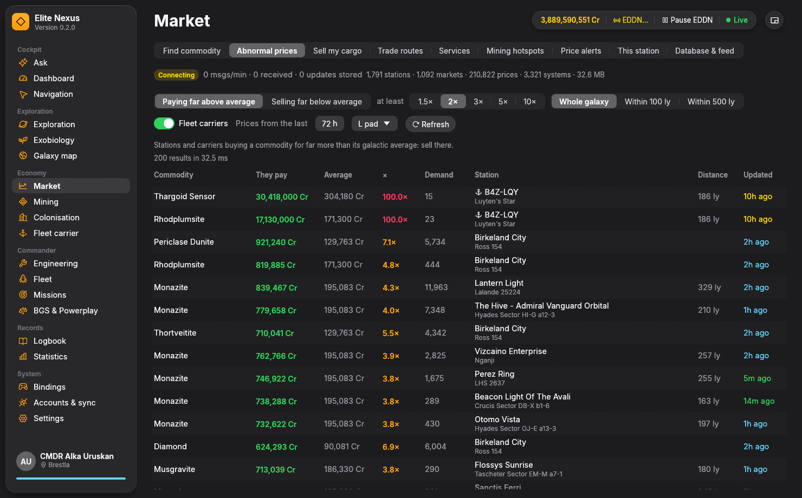 **Market** — abnormal prices across the galaxy |
| 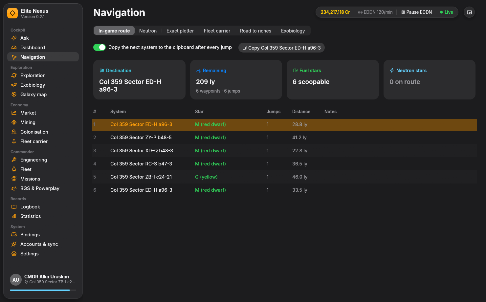 **Navigation** — route, fuel stars, next system to the clipboard | 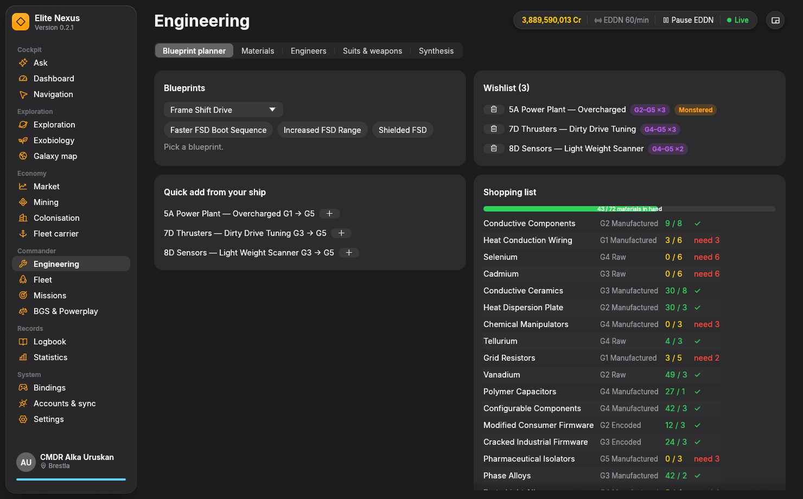 **Engineering** — wishlist and shopping list |
| 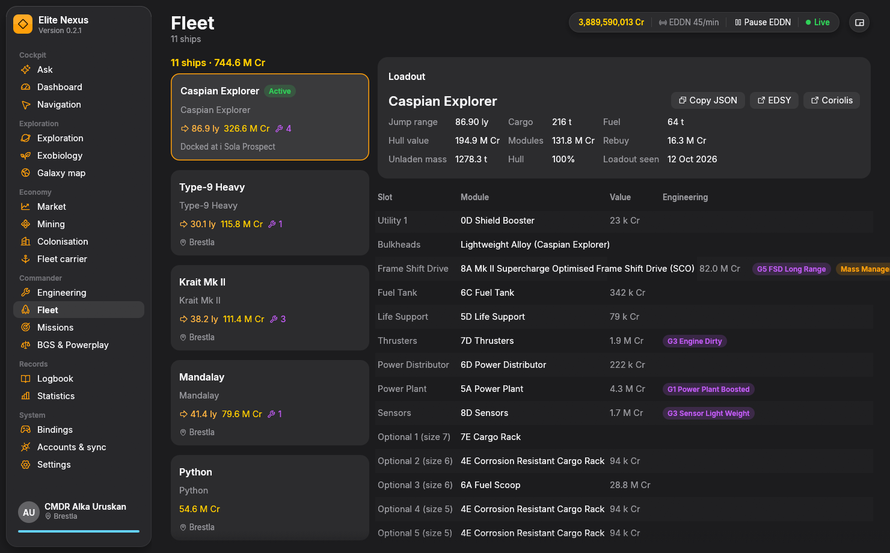 **Fleet** — loadouts, engineering, one-click EDSY/Coriolis | 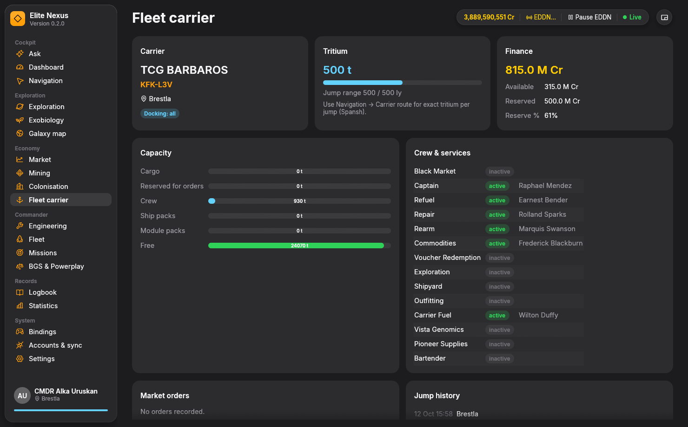 **Fleet carrier** — tritium, finances, crew |
| 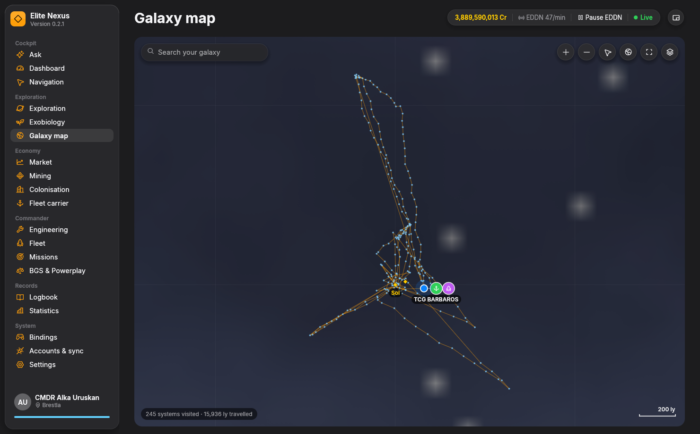 **Galaxy map** — your travels, ship and carrier | 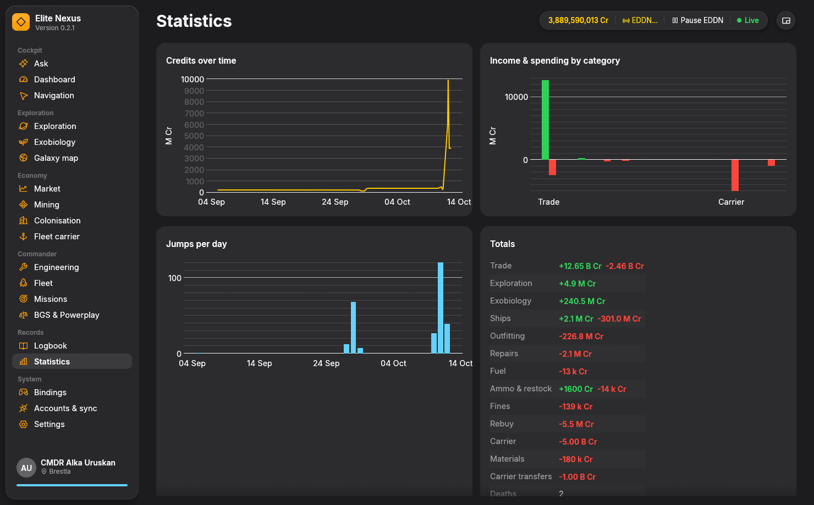 **Statistics** — credits, income, jumps |
| 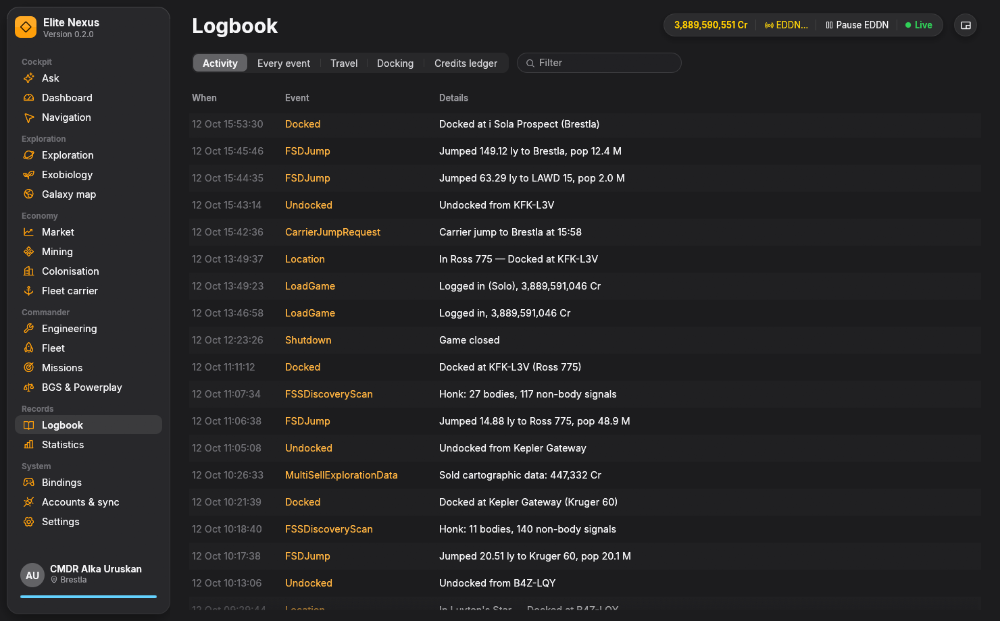 **Logbook** — every journal event, searchable | 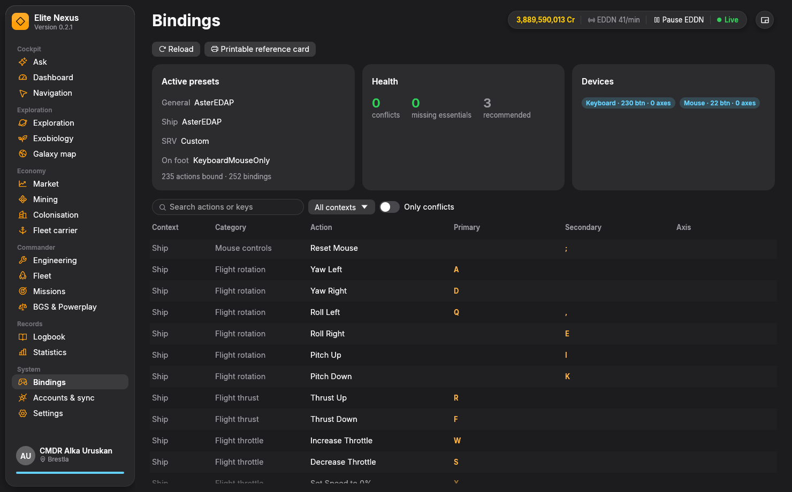 **Bindings** — presets, conflicts, reference card |
| 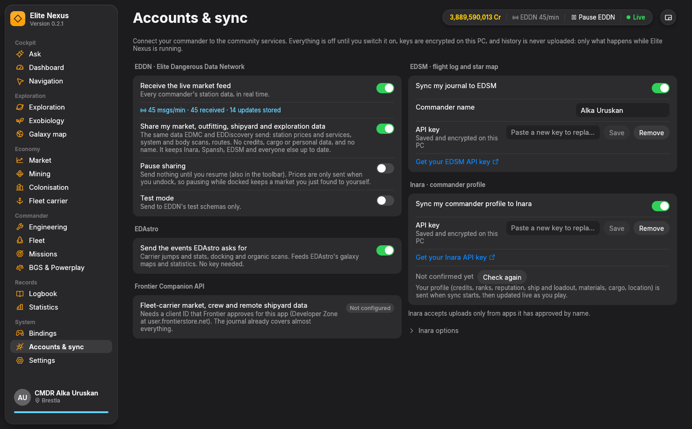 **Accounts & sync** — EDDN, EDSM, Inara, EDAstro | |

## Why it's faster

| | Elite Nexus |
|---|---|
| Full journal history load | **~40–60 ms** for 16.5k events (parallel parse, ~260 MB/s, 600k events/s) — EDD takes minutes on big histories |
| Live latency | journal + Status.json polled every **100 ms** (no missed writes, no notification lag) |
| Market data | **direct EDDN firehose** (~550 msgs/min) into a local SQLite DB — prices the moment any commander docks, before websites ingest them |
| Market queries | best price within 50 ly in **~1 ms**, galaxy-wide best price 0.2 ms, trade routes in 8–22 ms on an 80k-station / 4.4M-price database |
| Startup to usable | about one second |

## What works now

* **Ask** — a built-in AI co-pilot: ask in plain words ("where can I make the most money in the next hour?") and it
  answers from your ship, cargo, journal, the live market database and Spansh, with a knowledge base compiled into the
  app. Tools it can use: price deals (stations paying far above the galactic average), sell-my-cargo, trade routes,
  commodity search, nearest services, mining hotspots, system info, a system's planets (with who has set foot on them),
  untouched biology, route and money-route planning (routes land on the Navigation page), exobiology here, journal
  search. Setup is one pasted key (Google Gemini by default; Claude or a
  local model optional).

* **Dashboard** — commander, ranks & progress, credits, legal state, ship (fuel/hull/cargo/jump range/rebuy), location
  & system politics, session stats, current-system exploration value, holdings, fleet carrier, colonisation, activity feed.
* **Exploration** — every body as you FSS it: type, distance, value now vs. mapped (MattG formula, Odyssey bonus, first
  discovery/mapping, efficiency), gravity/temp/atmosphere, bio/geo signals, and Observatory-style highlights (ELW/WW/AW,
  terraformable, landable atmosphere, first footfall, close/wide rings, shepherd & nested moons, fast rotation/orbit,
  jumponium…). **Find valuable bodies** plans a scan tour (Spansh's Road to Riches) and widens the search out of the
  bubble by itself; **History** shows every system you scanned and whether its data was sold, refused or lost; codex.
* **Exobiology** — live **sampling radar**: previous sample points around you (oriented to your heading) with colony-range
  circles and a big "OK to sample / too close" readout; bio bodies with DSS genera; unsold Vista Genomics data with
  first-logged bonus (5×). **Species predictions** from the body's atmosphere, gravity, temperature, volcanism and parent
  stars before you land, with expected value (checked against your own history: for 15 of the 16 species you sampled,
  the top prediction for that genus was the right one). **Find planets**, two ways: a **bonus hunt** for planets where
  a valuable species should grow and nobody has a record of sampling it (first-logged bonus, ×5), which explains what
  it found and what the data can't prove, or **sure value**: planets where the species are already on record.
* **Market** — a local galaxy database fed live by EDDN, your own journal and (optionally) Spansh's daily dump:
  find the best/nearest place to buy or sell any commodity, **sell my cargo** (best single stop for the whole hold),
  trade routes for your ship and capital, nearest material traders / brokers / Interstellar Factors / Vista Genomics,
  mining hotspots with best sell prices, **price alerts** that fire seconds after any commander's market update
  matches your rule, and the full price list of the station you're docked at.
* **Navigation** — in-game route with scoopable/neutron/white-dwarf flags, non-scoopable streak warning, and **next
  system auto-copied to the clipboard after every jump**. Spansh planners built in: neutron, exact galaxy plotter
  (your ship's real FSD), fleet carrier (tritium); scan tours from Exploration and Exobiology land here too.
* **Fleet** — all ships, where they are (incl. in-transit), full loadouts with engineering & modifier deltas; one-click
  **Open in EDSY / Coriolis** with the exact build.
* **Engineering** — blueprint planner with a wishlist (or "upgrade to G5" from your ship), shopping list, material-trader
  plan, engineers (unlocked first, by distance), Odyssey suits & weapons, synthesis, materials and ship locker.
* **Missions** — active missions with expiry, cargo/kill progress, and a **massacre-stack tracker** (kills count once per
  issuing faction; shows exactly how many kills remain).
* **Mining** — live sessions: tonnes/hour, prospector quality, motherlodes.
* **Fleet carrier** — tritium, finances, capacity, crew/services, orders, jump schedule & history.
* **Colonisation** — construction depots with remaining tonnage per commodity, what's already in your hold, and
  **where to buy** each commodity nearest the site with stock for a full hold.
* **BGS & Powerplay** — what you did for which faction since the tick.
* **Logbook / Statistics / Galaxy map** — activity, every journal event with full-text search, travel, docking, a credits
  ledger by category, credit history, jumps per day, in-game statistics, and a map of everywhere you've been.
* **Bindings** — your active presets, conflicts, missing essentials, printable reference card.
* **Accounts & sync** — strictly compliant EDDN contribution, EDSM journal sync, Inara profile sync, EDAstro. All opt-in;
  only live events (never history); persistent retry queues that respect each service's rate limits.
* **Alerts & voice** — toasts plus Windows speech for high-value bodies, likely high-value biology, sample spacing,
  motherlodes, non-scoopable stars when fuel is low, interdictions, hull critical, mission completion, carrier jumps…
* **Compact HUD** — one click turns the window into a small always-on-top panel for a second screen.

## Build & run

Download the latest `EliteNexus-…-windows-x64.zip` from the GitHub Releases page, unzip anywhere, run `EliteNexus.exe`.

To build it yourself (Windows, [Rust](https://rustup.rs) stable):

```powershell
cargo run -p nexus-app                 # debug
cargo build --release -p nexus-app     # target\release\EliteNexus.exe
```

On the original dev machine the toolchain is not on PATH: run `. .\tools\env.ps1` first. Pushing a tag such as `v0.1.0`
makes GitHub Actions build the exe and publish a Release (`.github/workflows/release.yml`), with that version's
`CHANGELOG.md` section as the notes. Working on the code, as a person or an AI agent? Read `AGENTS.md` first.

Command-line options: `--page <name>`, `--tab <name>`, `--journal-dir <dir>`, `--mute`,
`--screenshot <png> [--shot-delay <s>] [--size <w>x<h>] [--demo]`. A screenshot run renders off-screen, saves the PNG
and exits; it never uploads. The images in `docs/screenshots/` were made this way, e.g.
`EliteNexus.exe --page market --tab abnormal --screenshot docs\screenshots\market.png --shot-delay 8 --mute`.
Data (settings, DB, logs) is kept in `nexus-data\` next to the executable.

Dev tools: `cargo run --release -p nexus-journal --example scan_journals` (parse stats),
`cargo run --release -p nexus-model --example summary` (everything the model knows),
`cargo run --release -p nexus-journal --example replay -- <journal> <dir> [speed]` (simulate a live session),
`cargo run --release -p nexus-model --example predictions` (exobiology predictions vs. what you sampled),
`cargo run --release -p nexus-uplink --example validate` (every upload your journals would produce, checked against the
EDDN schemas — sends nothing), `cargo run --release -p nexus-galaxy --example seed_journal -- <db>` (galaxy DB from
your journals), `cargo run -p nexus-eddn --example live -- <db> <seconds>` (watch the live EDDN feed).

## Accounts you may want

* **EDSM** API key: https://www.edsm.net/en/settings/api
* **Inara** API key: https://inara.cz/elite/cmdr-settings-api/ (Inara only accepts whitelisted app names: until
  "Elite Nexus" is approved, every request is rejected with "This application has no access allowed" and sync pauses.
  Keep "Developer mode" on for the first weeks after approval; see docs/research/inara.md)
* **Frontier Companion API (CAPI)** needs a client ID approved by Frontier (docs/research/capi.md) — optional; the
  journal already provides almost everything.

Keys are stored encrypted with Windows DPAPI.

## Docs

* `AGENTS.md` — how to work on this repo: machine rules, build/test/UI checks, parallel work, releases, open decisions.
* `CHANGELOG.md` — what changed in each release.
* `docs/USER_GUIDE.md` — every page explained (also the in-app assistant's knowledge).
* `docs/ARCHITECTURE.md` — crates, threads, conventions.
* `docs/research/` — verified specs: EDDN (live service differs from GitHub!), EDSM, Inara, CAPI, Spansh, websites,
  journal format, engineering data, exploration/exobiology science, and a 167-feature competitive matrix.

*Elite Dangerous is a trademark of Frontier Developments plc. Elite Nexus is an unofficial community tool.*
